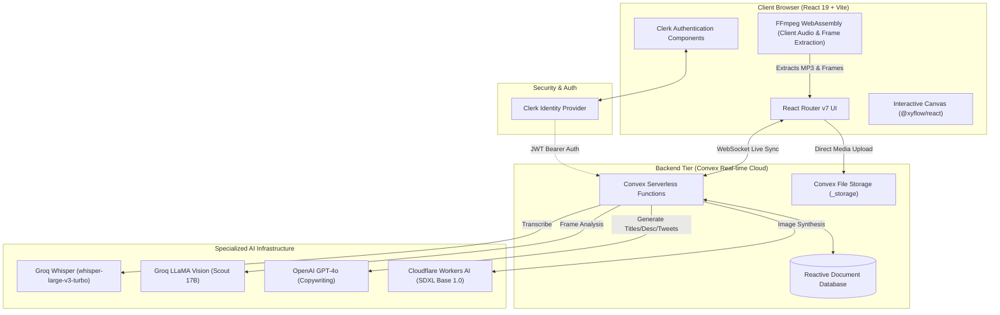

# Loomis — Complete Project Guide & Architectural Walkthrough

Welcome to the definitive guide to **Loomis** (formerly known as YouPac AI). This single document provides a complete, 4-part masterclass designed to teach any developer, collaborator, or stakeholder how the platform is architected, what tools it uses, how data flows through its AI pipeline, and how to deploy and maintain it.

---

# Table of Contents
- [PART 1: Project Overview, Vision & Architecture](#part-1-project-overview-vision--architecture)
  - [1.1 What is Loomis?](#11-what-is-loomis)
  - [1.2 The Core Problem Loomis Solves](#12-the-core-problem-loomis-solves)
  - [1.3 Mental Model: The Node Graph Workflow](#13-mental-model-the-node-graph-workflow)
  - [1.4 High-Level System Architecture](#14-high-level-system-architecture)
  - [1.5 Route Map & User Journeys](#15-route-map--user-journeys)
- [PART 2: Complete Tech Stack & Tools Catalog](#part-2-complete-tech-stack--tools-catalog)
  - [2.1 Frontend & Application Framework](#21-frontend--application-framework)
  - [2.2 Interactive Canvas Engine](#22-interactive-canvas-engine)
  - [2.3 Real-Time Backend & Storage](#23-real-time-backend--storage)
  - [2.4 Authentication & Security](#24-authentication--security)
  - [2.5 AI & Machine Learning Infrastructure](#25-ai--machine-learning-infrastructure)
  - [2.6 Client-Side Media Engineering](#26-client-side-media-engineering)
  - [2.7 UI Components & Design System](#27-ui-components--design-system)
  - [2.8 Forms, Data & Visualizations](#28-forms-data--visualizations)
  - [2.9 DevOps & Deployment](#29-devops--deployment)
- [PART 3: Step-by-Step Workflow & AI Pipeline](#part-3-step-by-step-workflow--ai-pipeline)
  - [3.1 Phase 1: Project Initialization & Channel Profiling](#31-phase-1-project-initialization--channel-profiling)
  - [3.2 Phase 2: In-Browser Video Ingestion & FFmpeg Processing](#32-phase-2-in-browser-video-ingestion--ffmpeg-processing)
  - [3.3 Phase 3: The Speech-to-Text Transcription Engine](#33-phase-3-the-speech-to-text-transcription-engine)
  - [3.4 Phase 4: Multi-Agent AI Generation Engine](#34-phase-4-multi-agent-ai-generation-engine)
  - [3.5 Phase 5: Dynamic Canvas Graph & Context Flow](#35-phase-5-dynamic-canvas-graph--context-flow)
  - [3.6 Phase 6: Floating Chat & Agent @Mention Refinement](#36-phase-6-floating-chat--agent-mention-refinement)
  - [3.7 Phase 7: Real-World Previews, Markdown Export & Sharing](#37-phase-7-real-world-previews-markdown-export--sharing)
- [PART 4: Database Schema, Backend API & Deployment](#part-4-database-schema-backend-api--deployment)
  - [4.1 Convex Reactive Database Schema](#41-convex-reactive-database-schema)
  - [4.2 Backend Serverless Functions Map](#42-backend-serverless-functions-map)
  - [4.3 Environment Variables Reference](#43-environment-variables-reference)
  - [4.4 Local Setup & Development Runbook](#44-local-setup--development-runbook)
  - [4.5 Production Deployment (Vercel & Docker)](#45-production-deployment-vercel--docker)
  - [4.6 Common Troubleshooting Scenarios](#46-common-troubleshooting-scenarios)

---

# PART 1: Project Overview, Vision & Architecture

## 1.1 What is Loomis?

**Loomis** is an AI-powered visual studio created specifically for content creators on YouTube. It replaces fractured creator workflows—jumping between video editors, ChatGPT, Photoshop, Google Docs, and Twitter—with a single, reactive, node-based canvas.

Given a raw video file or transcript, Loomis coordinates specialized AI agents to generate:
1. **High-CTR Video Titles** (SEO-optimized and audience-hooked)
2. **Structured Video Descriptions** (Value proposition, timestamps, links, and tags)
3. **Photorealistic Thumbnails** (Vision frame analysis + Stable Diffusion XL generation and refinement)
4. **Promotional Twitter/X Threads** (High-converting social distribution copy)

---

## 1.2 The Core Problem Loomis Solves

YouTube creators typically spend 80% of their energy filming and editing, only to rush the "packaging" phase. Yet packaging (title, thumbnail, description, social hook) accounts for over 90% of a video's initial Click-Through Rate (CTR) and algorithmic velocity.

```
Traditional Friction:
[Large Video] -> Wait 20 mins to upload -> Pay $15/hr for transcription -> 
Manual prompt copy-pasting -> Switch to Photoshop -> Manual tweet drafting

The Loomis Solution:
[Large Video] -> In-browser audio extraction in 5s -> Free Groq Whisper in 2s -> 
Node Canvas with 4 Specialized AI Agents -> Instant YouTube & Twitter simulation
```

---

## 1.3 Mental Model: The Node Graph Workflow

In Loomis, content creation is modeled as an **interactive directed acyclic graph (DAG)**:

```
Creator Profile (Niche, Brand Voice, Target Audience)
   │
   ▼
Project Canvas (1 Project = 1 Video)
   ├── [Video Node] ────────► [Title Agent] ─────────► [Twitter Agent]
   │       │                        │
   │       ▼                        ▼
   │   [Transcript Node]    [Thumbnail Agent]
   │                                │ (Vision + SDXL)
   └────────────────────────► [Description Agent]
```

- **Source Nodes** introduce raw data into the canvas: video playback, metadata (dimensions, duration, bitrate), and audio transcripts.
- **Agent Nodes** consume upstream data to produce copy and visual assets.
- **Edges (Connections)** define context dependencies. Linking a Title node to a Thumbnail node instructs the image diffusion engine to integrate the exact chosen title into the visual theme.

---

## 1.4 High-Level System Architecture

Loomis uses a modern serverless reactive stack that eliminates API latency and state synchronization bugs:



---

## 1.5 Route Map & User Journeys

The application frontend is structured cleanly using React Router v7:

- `/` — Marketing landing page, social proof, live platform statistics.
- `/sign-in/*` & `/sign-up/*` — Secure Clerk authentication flows.
- `/dashboard` — Projects dashboard (grid view, creation modals, usage charts).
- `/dashboard/project/:projectId` — The primary workspace: the infinite visual canvas.
- `/dashboard/settings` — Channel profile customization (niche, voice, default links).
- `/share/:shareId` — Public, read-only canvas snapshot with interactive previews and view counting.

---

# PART 2: Complete Tech Stack & Tools Catalog

Here is an exhaustive breakdown of **every tool, library, API, and service** used in Loomis:

## 2.1 Frontend & Application Framework

| Tool | Version | What it is | Why we use it in Loomis |
| :--- | :--- | :--- | :--- |
| **React** | `19.1.0` | Leading declarative UI library | Modern concurrent rendering, fast reconciliation for drag-and-drop operations, and hook ergonomics. |
| **React Router** | `7.5.3` | Full-stack framework (formerly Remix) | File-based routing, server-side rendering (SSR), data loaders, action handlers, and zero-config deployment. |
| **Vite** | `6.3.3` | Frontend build tool & HMR server | Sub-second dev server startup, instant hot-reloading, and native WebAssembly worker bundling. |
| **TypeScript** | `5.8.3` | Typed JavaScript superset | Guarantees end-to-end type safety between Convex database schemas and React component props. |

---

## 2.2 Interactive Canvas Engine

| Tool | Version | What it is | Why we use it in Loomis |
| :--- | :--- | :--- | :--- |
| **XYFlow (React Flow)** | `12.7.0` | Node-based interactive diagramming engine | Renders the infinite spatial canvas, handles edge connections, port snapping, zooming, panning, and mini-map. |
| **D3-Drag** | `3.0.0` | Touch & pointer gesture drag engine | Powers custom draggable handles on canvas cards (e.g. the hamburger drag grips). |

---

## 2.3 Real-Time Backend & Storage

| Tool | Version | What it is | Why we use it in Loomis |
| :--- | :--- | :--- | :--- |
| **Convex** | `1.24.3` | Reactive backend-as-a-service (BaaS) | Replaces traditional REST/GraphQL APIs. Pushes database changes live over WebSockets so multiple browser tabs remain in perfect sync. |
| **Convex Storage** | Built-in | Global object storage (`_storage`) | Directly stores video files, compressed audio clips, and generated PNG thumbnail files with persistent URLs. |
| **Polar SDK** | `0.32.16` | Developer-first billing infrastructure | Handles subscription tiers and developer monetization. |

---

## 2.4 Authentication & Security

| Tool | Version | What it is | Why we use it in Loomis |
| :--- | :--- | :--- | :--- |
| **Clerk** | `1.4.8` | Auth and user identity management | Turnkey sign-in/up dialogs, session tokens, and cryptographically verified JWT handoffs to Convex backend functions. |

---

## 2.5 AI & Machine Learning Infrastructure

| Service / SDK | Model | What it is & How Loomis uses it |
| :--- | :--- | :--- |
| **OpenAI SDK & Vercel AI SDK** | `gpt-4o` | Powers the **Title Agent**, **Description Agent**, and **Tweets Agent**. Crafts high-CTR copy based on video transcripts and channel profiles. |
| **Groq Whisper** | `whisper-large-v3-turbo` | Speech-to-text inference running on Groq LPUs. Transcribes a 10-minute audio track in ~1.8 seconds. |
| **Groq Vision** | `llama-4-scout-17b-16e-instruct` | Inspects extracted video keyframes to analyze human expressions, focal points, and scene contrast. |
| **Cloudflare Workers AI** | `stable-diffusion-xl-base-1.0` | High-throughput diffusion engine generating photorealistic 16:9 thumbnails (`cfTextToImage`) and refining them via img2img (`cfImageToImage`). |

---

## 2.6 Client-Side Media Engineering

| Library | Version | What it is & How Loomis uses it |
| :--- | :--- | :--- |
| **FFmpeg WebAssembly** | `0.12.15` | FFmpeg compiled to WASM. Extracts 128kbps MP3 audio from a 1GB video in the creator's browser, bypassing massive server uploads and staying under Groq's 25MB file limit. |
| **Video Metadata Pipeline** | Internal | Uses off-screen HTML5 video elements to extract duration, resolution, frame rates, and sample keyframe frames. |

---

## 2.7 UI Components & Design System

| Library | Purpose in Loomis |
| :--- | :--- |
| **Tailwind CSS v4** | Modern utility-first CSS engine compiled natively via `@tailwindcss/vite`. |
| **shadcn/ui & Radix UI** | Accessible dialogs, alert confirmations, tabs, dropdowns, and tooltips (`@radix-ui/*`). |
| **Framer Motion (`motion`)** | Fluid physics animations, modal entrances, and floating chat window popovers. |
| **Lucide React & Tabler Icons** | Crisp vector SVG icons used across nodes, toolbars, and dashboard cards. |
| **Sonner** | Clean toast notifications for save feedback and clipboard actions. |
| **Vaul** | Drawer primitives for mobile-responsive preview drawers. |

---

## 2.8 Forms, Data & Visualizations

| Library | Purpose in Loomis |
| :--- | :--- |
| **React Hook Form & Zod** | Strongly-typed form validation for user settings, channel bio, and custom prompts. |
| **Recharts** | Interactive SVG charts on the dashboard showing processed videos and generation metrics. |
| **TanStack Table** | Data grid management for project listings. |
| **React Markdown** | Parses and renders markdown text generated by AI agents into formatted previews. |
| **React Typed** | Dynamic typewriter animations on homepage headers. |

---

## 2.9 DevOps & Deployment

| Tool | Purpose in Loomis |
| :--- | :--- |
| **Vercel** | Edge-rendered SSR hosting via the official `@vercel/react-router` preset. |
| **Docker** | Multi-stage production container build for deploying to AWS, Cloud Run, or self-hosted servers. |

---

# PART 3: Step-by-Step Workflow & AI Pipeline

Let's walk through the entire lifecycle of a project in Loomis from the creator's perspective:

```
[1. Profile Setup] ──► [2. Upload Video] ──► [3. FFmpeg Extraction] ──► [4. Groq Whisper]
                                                                               │
[7. Preview & Export] ◄── [6. @Mention Chat] ◄── [5. 4 Agent Generators] ◄─────┘
```

---

## 3.1 Phase 1: Project Initialization & Channel Profiling

1. The creator visits `/dashboard/settings` and configures their **Channel Profile**:
   - Channel Name, Niche (e.g. *AI & Software Engineering*)
   - Tone (e.g. *Authoritative, Practical, Punchy*)
   - Target Audience (e.g. *Full-stack developers and tech founders*)
   - Social & Website Links
2. The creator visits `/dashboard` and clicks **"New Project"**.
3. A record is added to the `projects` table in Convex, and the user is redirected to `/dashboard/project/:projectId`.

---

## 3.2 Phase 2: In-Browser Video Ingestion & FFmpeg Processing

1. The creator drags a video (e.g. `tutorial.mp4`, up to 1GB) onto the canvas or hits `Cmd+U`.
2. **Metadata Extraction (`app/lib/video-metadata.ts`):** Off-screen HTML5 video element calculates duration, natural resolution (1920x1080), and aspect ratio.
3. **WebAssembly Audio Extraction (`app/lib/ffmpeg-audio.ts`):**
   - `@ffmpeg/ffmpeg` spins up a browser worker.
   - Converts the video track into a 128kbps MP3:
     ```bash
     ffmpeg -i input.mp4 -vn -acodec mp3 -b:a 128k output.mp3
     ```
   - A 500MB video becomes a 7MB MP3 file in ~4 seconds!
4. **Keyframe Capture (`app/lib/video-frames.ts`):** FFmpeg captures 3 freeze-frame images (at 25%, 50%, and 75% timestamps) to use for thumbnail vision analysis.
5. Audio and video files upload to Convex Storage (`_storage`).

---

## 3.3 Phase 3: The Speech-to-Text Transcription Engine

1. `convex/transcription.ts` is invoked automatically via a Convex action.
2. The action streams the audio file to **Groq Whisper** (`whisper-large-v3-turbo`).
3. Status moves from `idle` $\rightarrow$ `processing` $\rightarrow$ `completed`.
4. The full timestamped transcript is stored in the `videos` database record.
5. **Fallback:** If a user already has subtitles, they can drag a `.srt` or `.vtt` file directly into a `TranscriptionNode`.

---

## 3.4 Phase 4: Multi-Agent AI Generation Engine

The creator clicks **"Generate All"** or triggers individual agent nodes:

### 1. Title Agent (`gpt-4o`)
- **Optimization Strategy:** High Click-Through Rate without deceitful clickbait.
- **Constraints:** Under 60 characters (prevents truncation on mobile), front-loading high-curiosity keywords in the first 30 characters.
- **Formulas:** Educational (*"How to X in Y"*), Story (*"I Tested X for 30 Days"*), or Contrarian (*"Why You Should Stop Using X"*).

### 2. Description Agent (`gpt-4o`)
- **Structure:**
  - First 2 lines: The core benefit (above-the-fold hook).
  - Timestamps: Automatically identified from major topic transitions in the transcript.
  - Links & Bio: Automatically inserted from the Channel Profile.
  - SEO Tags: 3 to 5 targeted hashtags.

### 3. Thumbnail Agent (Groq Vision + Cloudflare SDXL)
- **Step A:** Groq Vision analyzes the 3 extracted keyframes, identifying subjects, lighting, and expressions.
- **Step B:** Cloudflare Workers AI (`@cf/stabilityai/stable-diffusion-xl-base-1.0`) synthesizes a 16:9 photorealistic image.
- **Step C:** The PNG is saved permanently in Convex Storage.
- **Step D (Refinement):** Creators can request modifications (e.g., *"Make background darker, add neon highlights"*), which uses SDXL img2img (`cfImageToImage`) with a 0.65 denoising strength.

### 4. Tweets Agent (`gpt-4o`)
- **Format:** 2-tweet viral format.
  - Tweet 1: Hook and problem statement designed to generate impressions.
  - Tweet 2: Key takeaways, thumbnail preview attachment, and link to the YouTube video.

---

## 3.5 Phase 5: Dynamic Canvas Graph & Context Flow

- Nodes are rendered using `@xyflow/react`.
- Connecting an edge between two nodes passes downstream context:
  - `Video Node` $\rightarrow$ passes video duration and transcript.
  - `Title Node` $\rightarrow$ `Thumbnail Node` passes the chosen title to guide the visual theme.
- The canvas automatically persists its state (node coordinates, connections, zoom levels) to the Convex database every 5 seconds.

---

## 3.6 Phase 6: Floating Chat & Agent @Mention Refinement

A persistent floating chat window (`FloatingChat.tsx`) allows conversational revisions:
- Type `@title make it shorter and punchier`
- Type `@description add timestamps for the database section`
- Type `@thumbnail change the background to a cyberpunk city`
- The system reads the target agent, injects conversation history, updates the draft, and re-renders the node in real time.

---

## 3.7 Phase 7: Real-World Previews, Markdown Export & Sharing

1. **YouTube Preview Sheet (`YouTubePreview.tsx`):**
   - Renders a realistic YouTube video watch page with 16:9 video player, views counter, subscriber count, and expandable description box.
2. **Twitter Thread Preview (`TwitterThreadPreview.tsx`):**
   - Displays authentic Twitter/X cards with profile picture, formatted copy, and attached thumbnail.
3. **Markdown Export:** One-click download of a structured `.md` file for YouTube Studio.
4. **Public Share Links (`/share/:shareId`):** Generates a read-only URL with live view tracking for sharing with collaborators.

---

# PART 4: Database Schema, Backend API & Deployment

## 4.1 Convex Reactive Database Schema

Defined in `convex/schema.ts`:

```typescript
// Core Data Models
users: {
  name?: string,
  email?: string,
  image?: string,
  tokenIdentifier: string // Clerk JWT subject
} (indexed by tokenIdentifier)

projects: {
  userId: string,
  title: string,
  description?: string,
  thumbnail?: string,
  createdAt: number,
  updatedAt: number,
  isArchived: boolean
} (indexed by userId, updatedAt)

videos: {
  userId: string,
  projectId?: Id<"projects">,
  title?: string,
  storageId?: Id<"_storage">,
  transcription?: string,
  duration?: number,
  resolution?: { width: number, height: number },
  canvasPosition: { x: number, y: number },
  transcriptionStatus?: "idle" | "processing" | "completed" | "failed"
} (indexed by userId, projectId)

agents: {
  videoId: Id<"videos">,
  userId: string,
  projectId?: Id<"projects">,
  type: "title" | "description" | "thumbnail" | "tweets",
  draft: string,
  thumbnailUrl?: string,
  thumbnailStorageId?: Id<"_storage">,
  connections: string[],
  chatHistory: Array<{ role: "user" | "ai", message: string, timestamp: number }>,
  canvasPosition: { x: number, y: number },
  status: "idle" | "generating" | "ready" | "error"
} (indexed by videoId, type, project)

projectCanvases: {
  userId: string,
  projectId: Id<"projects">,
  nodes: Array<{ id: string, type: string, position: { x: number, y: number }, data: any }>,
  edges: Array<{ id: string, source: string, target: string }>,
  viewport: { x: number, y: number, zoom: number },
  updatedAt: number
} (indexed by projectId)

shares: {
  shareId: string,
  projectId: Id<"projects">,
  canvasState: { nodes: any[], edges: any[], viewport?: any },
  viewCount: number
} (indexed by shareId)
```

---

## 4.2 Backend Serverless Functions Map

| File Path | Function Name & Type | Description |
| :--- | :--- | :--- |
| `convex/aiHackathon.ts` | `generateContentSimple` *(Action)* | Main LLM action for Title, Description, and Tweet generation using GPT-4o. |
| `convex/aiProviders.ts` | `groqVisionChat`, `cfTextToImage`, `cfImageToImage` | Driver functions for Groq Vision and Cloudflare SDXL image synthesis. |
| `convex/thumbnailGPTImage.ts` | `generateThumbnailWithGPTImage` *(Action)* | Generates thumbnails from video frames and stores PNG blobs in Convex storage. |
| `convex/thumbnailRefine.ts` | `refineThumbnailWithGPTImage` *(Action)* | Refines existing thumbnails using SDXL img2img. |
| `convex/transcription.ts` | `transcribeVideoGroq` *(Action)* | Sends audio from Convex storage to Groq Whisper and saves transcript text. |
| `convex/videos.ts` | `generateUploadUrl`, `createVideo` *(Mutations)* | Video upload URL generator and metadata recorder. |
| `convex/canvas.ts` | `saveProjectCanvas`, `getProjectCanvas` *(Mutations & Queries)* | Auto-saves and restores canvas graph layout and viewport coordinates. |
| `convex/chat.ts` | `sendMessage`, `getMessages` *(Mutations & Queries)* | Manages chat history and dispatches `@mention` revisions. |
| `convex/projects.ts` | `createProject`, `getProjects`, `deleteProject` | Full CRUD operations for projects. |
| `convex/shares.ts` | `createShare`, `getShare` | Manages read-only public sharing links. |

---

## 4.3 Environment Variables Reference

### Application Variables (`.env.local`)
```bash
# Convex Deployment
CONVEX_DEPLOYMENT=dev:your-deployment-name
VITE_CONVEX_URL=https://your-deployment.convex.cloud

# Clerk Authentication
VITE_CLERK_PUBLISHABLE_KEY=pk_test_...
CLERK_SECRET_KEY=sk_test_...

# Frontend URL
FRONTEND_URL=http://localhost:5173
```

### Convex Cloud Dashboard Variables
Set via `npx convex env set <KEY> <VALUE>`:
- `OPENAI_API_KEY`: Enables GPT-4o copywriting and DALL-E 3 fallback.
- `GROQ_API_KEY`: Enables Groq Whisper transcription and LLaMA Vision.
- `CF_ACCOUNT_ID`: Cloudflare account ID for Workers AI.
- `CF_API_TOKEN`: Cloudflare API token with Workers AI access.

---

## 4.4 Local Setup & Development Runbook

```bash
# 1. Clone repository
git clone https://github.com/your-username/YOUPAC-AI.git
cd YOUPAC-AI

# 2. Install dependencies
npm install

# 3. Setup environment configuration
cp .env.example .env.local

# 4. Initialize Convex backend (in Terminal 1)
npx convex dev

# 5. Start the React Router v7 dev server (in Terminal 2)
npm run dev
```

---

## 4.5 Production Deployment (Vercel & Docker)

### Deploying to Vercel
1. Push repository to GitHub.
2. Link project in Vercel.
3. Add environment variables (`VITE_CONVEX_URL`, `VITE_CLERK_PUBLISHABLE_KEY`, `CLERK_SECRET_KEY`, `FRONTEND_URL`).
4. Set backend variables in Convex production dashboard.
5. Deploy (Vercel uses `@vercel/react-router` preset automatically).

### Deploying via Docker
```bash
docker build -t loomis .
docker run -p 3000:3000 \
  -e VITE_CONVEX_URL="https://your-deployment.convex.cloud" \
  -e VITE_CLERK_PUBLISHABLE_KEY="pk_live_..." \
  -e CLERK_SECRET_KEY="sk_live_..." \
  -e FRONTEND_URL="https://your-app.com" \
  loomis
```

---

## 4.6 Common Troubleshooting Scenarios

1. **FFmpeg SharedArrayBuffer Errors:** Ensure server headers include:
   ```
   Cross-Origin-Opener-Policy: same-origin
   Cross-Origin-Embedder-Policy: require-corp
   ```
2. **Groq Whisper 413 / Payload Too Large:** FFmpeg WASM extracts audio to MP3 `<25MB` before upload. If a file fails, ensure the audio compression step completed before triggering transcription.
3. **React Flow Hydration Mismatch:** Always wrap canvas components in client-only boundaries (`ClientCanvas.tsx`).

---

*Loomis — Built with React Router v7, Convex, Groq, and Cloudflare Workers AI.*
