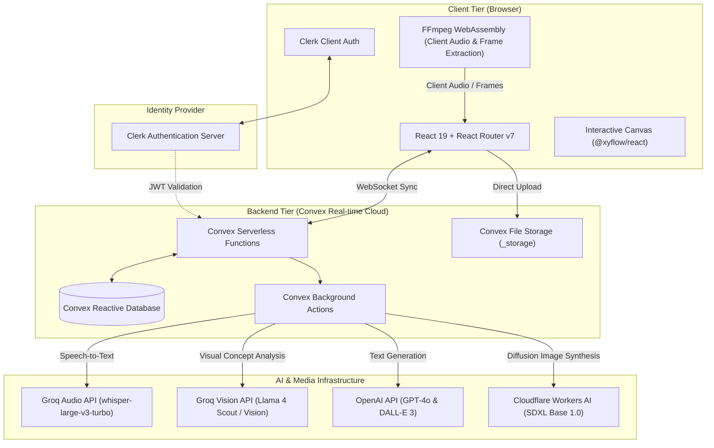
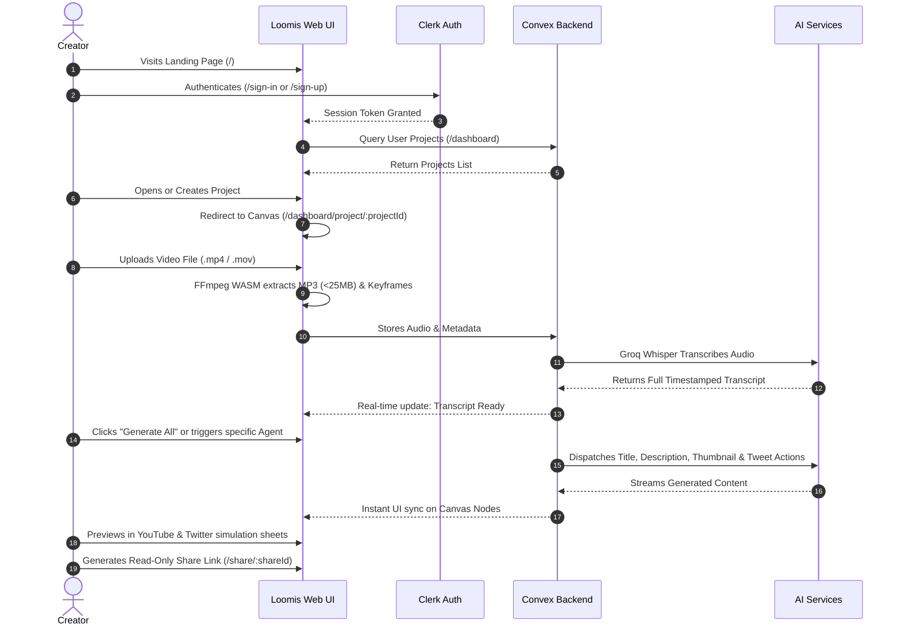

# Loomis — Part 1: Project Overview & Architecture

Welcome to **Loomis** (YouTube Package AI). This document is **Part 1** of a 4-part comprehensive guide designed to teach you the philosophy, user experience, and structural architecture of the Loomis platform.

---

## Table of Contents
1. [What is Loomis?](#what-is-Loomis-ai)
2. [The Core Problem It Solves](#the-core-problem-it-solves)
3. [The Core Mental Model](#the-core-mental-model)
4. [High-Level System Architecture](#high-level-system-architecture)
5. [User Flow & Page Routes Breakdown](#user-flow--page-routes-breakdown)
6. [Key Design Principles & UX Patterns](#key-design-principles--ux-patterns)
7. [Navigation Across the Documentation](#navigation-across-the-documentation)

---

## 1. What is Loomis?

**Loomis** is an intelligent, visual, end-to-end studio for content creators, specifically optimized for YouTube. Instead of treating content creation as disjointed steps—editing a video in one tool, writing titles in ChatGPT, drafting descriptions in a text editor, designing thumbnails in Photoshop, and rewriting threads on X (formerly Twitter)—Loomis unifies the entire post-production packaging workflow into a **single visual node-based canvas**.

By providing a single video file or transcript, Loomis orchestrates specialized AI agents that extract metadata, transcribe speech, analyze key moments, and generate:
- **High-CTR Video Titles** (SEO-optimized, hook-focused)
- **Compelling Video Descriptions** (Timestamps, value propositions, social links)
- **Eye-Catching YouTube Thumbnails** (Synthesized using state-of-the-art vision and image diffusion models)
- **Promotional Social Media Content** (Multi-tweet threads designed for Twitter/X)

---

## 2. The Core Problem It Solves

Most YouTube creators spend 80% of their energy filming and editing, only to rush the "packaging" (titles, thumbnail, description, tags, social distribution) at the last minute. Yet on YouTube, **packaging determines 90% of a video's initial impressions and Click-Through Rate (CTR)**.

### Traditional Packaging Friction
| Stage | Traditional Bottleneck | Loomis Solution |
| :--- | :--- | :--- |
| **Transcription** | Uploading to separate transcription services, waiting minutes, paying per-minute transcription fees. | Lightning-fast audio extraction via client-side WebAssembly FFmpeg + Groq Whisper (`whisper-large-v3-turbo`) in seconds. |
| **Ideation** | Copy-pasting partial scripts into generic chatbots with no context of past channel voice or video framing. | Persistent Channel Profiles + full transcript injection into specialized prompt templates. |
| **Thumbnails** | Manually scrub video for freeze-frames, switch to Midjourney/Photoshop, struggle with text/faces. | Video keyframe extraction directly analyzed by Groq Vision, then synthesized via Cloudflare SDXL / DALL-E 3 with img2img refinement. |
| **Workflow** | Linear forms that lock user into rigid step-by-step wizards. | Infinite interactive canvas (`@xyflow/react`) where nodes can be connected, branched, duplicated, and rearranged. |
| **Collaboration** | Screenshotting drafts to send to editors or managers over Slack/Discord. | One-click shareable read-only links (`/share/:shareId`) preserving complete canvas layout and preview simulations. |

---

## 3. The Core Mental Model

Loomis is designed around a simple, powerful hierarchy:

```
User (Clerk Auth)
 └── Channel Profile (Brand voice, Niche, Target audience)
      └── Projects (1 Project = 1 Video Concept)
           └── Canvas (Infinite Workspace)
                ├── Video Node (Upload, Playback, Metadata, Audio Extraction)
                ├── Transcription Node (Automated or Manual Transcripts)
                ├── Title Agent Node (CTR Titles)
                ├── Description Agent Node (Summary & Links)
                ├── Thumbnail Agent Node (Visual Concept & SDXL Generation)
                ├── Tweets Agent Node (Social Distribution Thread)
                └── Moodboard Node (Inspirational references & styling)
```

### The "Node Graph" Paradigm
Instead of a static dashboard with forms, Loomis uses an interactive **directed graph**:
- **Source Nodes** provide data (the uploaded video file, extracted audio, transcribed dialogue).
- **Agent Nodes** consume that data and produce creative assets.
- **Edges (Connections)** define context dependencies. For example:
  - If you connect `Video Node` $\rightarrow$ `Title Node`, the Title Agent uses the transcript to suggest titles.
  - If you connect `Title Node` $\rightarrow$ `Thumbnail Node`, the Thumbnail Agent incorporates the chosen title into the visual concept and background composition.
  - If you connect `Title Node` + `Description Node` $\rightarrow$ `Tweets Node`, the Twitter Agent crafts a thread summarizing the core thesis and plugging the YouTube video.

---

## 4. High-Level System Architecture

Loomis leverages a modern, full-stack, serverless, reactive architecture:



### Architecture Pillars:
1. **Zero-Lag Reactivity (Convex):** Every change to a node, position, text draft, or chat message updates in the Convex database and streams via WebSockets instantly to the frontend. There are no manual polling intervals or stale cache invalidations.
2. **Client-Side Heavy Lifting (FFmpeg WASM):** Video files up to 1GB can be large. Rather than uploading hundreds of megabytes to a server just to extract audio, Loomis runs FFmpeg compiled to WebAssembly inside the user's browser. It extracts a lightweight 128kbps MP3 audio file and keyframe snapshots locally, reducing server bandwidth by up to 95%.
3. **Multi-Model AI Orchestration:** Rather than relying on a single vendor, Loomis utilizes best-in-class models tailored for specific tasks:
   - **Groq** for near-instant transcription and vision processing.
   - **OpenAI GPT-4o** for nuanced, high-converting copywriting.
   - **Cloudflare Workers AI (Stable Diffusion XL)** for cost-effective, high-resolution thumbnail generation.

---

## 5. User Flow & Page Routes Breakdown

The application is structured cleanly using React Router v7 file-based routing:

```
app/routes/
├── home.tsx                     # Landing Page (/)
├── sign-in.tsx                  # Clerk Sign-In (/sign-in/*)
├── sign-up.tsx                  # Clerk Sign-Up (/sign-up/*)
├── share.$shareId.tsx           # Public Shared Read-Only Canvas (/share/:shareId)
└── dashboard/
    ├── layout.tsx               # Dashboard Navigation Shell (Sidebar, Header)
    ├── index.tsx                # Projects Grid (/dashboard)
    ├── project.$projectId.tsx   # Visual Canvas Studio (/dashboard/project/:projectId)
    ├── chat.tsx                 # Global Assistant Chat (/dashboard/chat)
    └── settings.tsx             # Channel Profile & Brand Persona (/dashboard/settings)
```

### Step-by-Step Walkthrough:



---

## 6. Key Design Principles & UX Patterns

1. **Spatial Canvas Workspace:** Content creation is non-linear. The infinite canvas powered by `@xyflow/react` gives creators space to think, experiment with multiple titles, compare thumbnail options, and link ideas together visually.
2. **Context-Aware Floating Chat:** In addition to node-specific buttons, a floating global chat window allows creators to query `@title`, `@description`, `@thumbnail`, or `@tweets`. The chat automatically reads the video transcript, channel profile, and connected node drafts to iterate on content conversationally.
3. **High-Fidelity Previewing:** Creators do not publish raw markdown; they want to see how their title truncates on a smartphone screen, or how their thumbnail stands out against YouTube's dark theme. Integrated preview modals simulate authentic YouTube video pages and Twitter feeds.
4. **Resilient Persistence:**
   - Canvas zoom, node coordinates, and viewport panning auto-save every 5 seconds.
   - Deletions are safeguarded with accessible modal confirmations.
   - Large video processing failures are caught with graceful fallback states (e.g., manual transcript upload).

---

## 7. Navigation Across the Documentation

To continue mastering the Loomis codebase, explore the remaining 3 parts:

- **[Part 2: Tech Stack & Tools Deep Dive](./PART_2_TECH_STACK_AND_TOOLS.md)**  
  *Detailed breakdown of every single library, framework, SDK, and service used in the project.*
- **[Part 3: Workflow & AI Pipeline](./PART_3_WORKFLOW_AND_AI_PIPELINE.md)**  
  *Step-by-step walkthrough of video ingestion, FFmpeg processing, transcription, multi-agent prompting, and chat refinement.*
- **[Part 4: Database Schema, API & Deployment](./PART_4_DATABASE_SCHEMA_AND_API.md)**  
  *Exhaustive reference for all Convex database tables, serverless functions, environment variables, and deployment instructions.*
