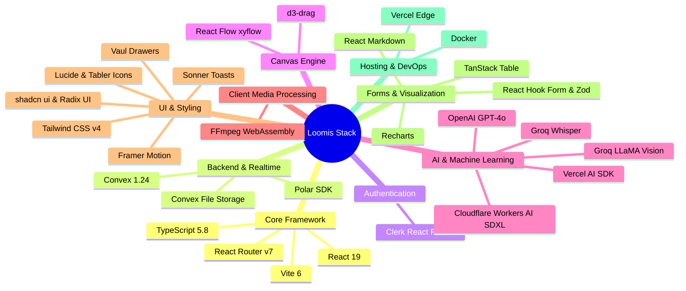

# Loomis — Part 2: Tech Stack & Tools Deep Dive

Welcome to **Part 2** of the Loomis documentation series. In this part, we examine **every single tool, library, API, framework, and service** utilized across the codebase.

For each tool, you will learn:
1. **What it is** (Plain English explanation).
2. **Why we chose it** (The technical rationale for this project).
3. **Where and how it is used** (Specific files and workflow responsibilities).

---

## Master Architecture & Technology Categorization

---

## 1. Core Framework & Runtime

### React 19 (`react`, `react-dom` v19.1.0)
- **What it is:** The premier JavaScript library for building component-driven user interfaces, featuring the latest concurrent rendering, server actions, and enhanced asset prefetching.
- **Why we chose it:** Provides ultra-smooth UI interactions, automatic batching for high-frequency canvas updates, and modern hook ergonomics required for real-time collaboration.
- **Where it is used:** Every UI view in `app/`, custom hooks in `app/hooks/`, and stateful canvas elements in `app/components/canvas/`.

### React Router v7 (`react-router`, `@react-router/node`, `@react-router/serve`, `@react-router/dev` v7.5.3)
- **What it is:** The evolution of Remix and React Router into a unified full-stack framework with Server-Side Rendering (SSR), route nesting, data loaders, actions, and client/server type safety.
- **Why we chose it:** Offers unmatched developer experience for file-based nested routing, server-side data prefetching, and seamless production hosting via `@vercel/react-router`.
- **Where it is used:**
  - Route configurations: `app/routes.ts`, `react-router.config.ts`
  - Application shell & root provider tree: `app/root.tsx`
  - Route handlers: `app/routes/home.tsx`, `app/routes/dashboard/`, `app/routes/share.$shareId.tsx`.

### Vite 6 (`vite`, `vite-tsconfig-paths`, `@tailwindcss/vite` v6.3.3)
- **What it is:** The next-generation frontend build tool and dev server powered by native ES modules and Rollup.
- **Why we chose it:** Instantaneous Hot Module Replacement (HMR) and rapid build times even when processing large WebAssembly modules and heavy CSS dependencies.
- **Where it is used:** `vite.config.ts` manages bundle plugins, WebAssembly worker compatibility, and path alias resolution (`@/*`).

### TypeScript 5.8 (`typescript`, `@types/node`, `@types/react`, `@types/react-dom`)
- **What it is:** Strongly-typed superset of JavaScript that compiles down to clean, optimized JavaScript.
- **Why we chose it:** Eliminates runtime type errors across the boundary between Convex database documents and frontend React components.
- **Where it is used:** Configured in `tsconfig.json` and utilized across all `.ts` and `.tsx` files in the project.

---

## 2. Interactive Canvas Engine

### React Flow / XYFlow (`@xyflow/react` v12.7.0)
- **What it is:** The industry standard library for building interactive node-based editors, visual workflows, and diagramming tools.
- **Why we chose it:** Loomis replaces conventional forms with an intuitive visual node graph. React Flow provides built-in panning, zooming, custom node rendering, handle connection snapping, and mini-map support.
- **Where it is used:**
  - Main canvas orchestrator: `app/components/canvas/Canvas.tsx`
  - Custom nodes:
    - `app/components/canvas/VideoNode.tsx` (Video preview, metadata, upload triggers)
    - `app/components/canvas/AgentNode.tsx` (Title, description, thumbnail, tweet cards)
    - `app/components/canvas/TranscriptionNode.tsx` (Transcript text & manual upload)
    - `app/components/canvas/MoodBoardNode.tsx` (Reference visual assets)
  - Layout wrappers and hydration safety: `ClientCanvas.tsx`, `ReactFlowWrapper.tsx`, `app/styles/reactflow.css`.

### D3-Drag (`d3-drag` v3.0.0)
- **What it is:** A specialized D3 module that provides robust, cross-device mouse and touch gesture drag behaviors.
- **Why we chose it:** Empowers custom draggable handles (like the hamburger drag icons on nodes) and smooth coordinate tracking without jitter.
- **Where it is used:** `app/components/canvas/Canvas.tsx` for custom node re-positioning and collision detection.

---

## 3. Real-Time Backend & Database

### Convex (`convex` v1.24.3)
- **What it is:** A reactive cloud backend database and serverless compute engine designed for modern web apps.
- **Why we chose it:** Unlike traditional REST or GraphQL databases that require polling or manual WebSocket wiring, Convex automatically pushes real-time query updates whenever data changes in the database.
- **Where it is used:**
  - Database schema: `convex/schema.ts` (defines `users`, `projects`, `videos`, `agents`, `profiles`, `shares`, `projectCanvases`, `transcriptions`)
  - Serverless queries and mutations:
    - `convex/projects.ts` (Project creation, listing, deletion)
    - `convex/videos.ts` (Video metadata storage, status flags)
    - `convex/agents.ts` (Agent state, draft storage, connections)
    - `convex/canvas.ts` (Canvas viewport and node graph persistence)
    - `convex/chat.ts` (Chat thread history between user and agents)
    - `convex/shares.ts` (Public shared canvas management)
    - `convex/profiles.ts` (Channel preferences & target audience).

### Convex File Storage (`_storage`)
- **What it is:** Built-in global object storage provided directly within the Convex backend.
- **Why we chose it:** Direct upload capabilities with signed URLs; stored files seamlessly generate secure, permanent URLs through `ctx.storage.getUrl()`.
- **Where it is used:**
  - Storing uploaded user video clips (`convex/files.ts`)
  - Storing extracted audio files for Groq transcription (`convex/transcription.ts`)
  - Storing generated thumbnail images permanently (`convex/thumbnail.ts`, `convex/thumbnailGPTImage.ts`).

### Polar Monetization (`@convex-dev/polar`, `@polar-sh/sdk`)
- **What it is:** Developer-first merchant-of-record subscription and payment infrastructure.
- **Why we chose it:** Integrated to handle creator billing, subscription tiers, and generation quota management directly inside Convex.
- **Where it is used:** Configured in `convex/convex.config.ts` and managed through polar webhook helpers.

---

## 4. Authentication & Security

### Clerk (`@clerk/react-router` v1.4.8)
- **What it is:** Complete authentication, user profile management, and session verification platform.
- **Why we chose it:** Provides production-grade security, social sign-ins (Google, GitHub), multi-factor authentication, and turnkey React components that integrate natively with React Router v7 and Convex JWT validation.
- **Where it is used:**
  - Route views: `app/routes/sign-in.tsx`, `app/routes/sign-up.tsx`
  - Auth provider wrapper: `app/root.tsx` (`<ClerkProvider>`)
  - Convex backend JWT verification: `convex/auth.config.ts` ensuring all mutations and queries require authenticated creator tokens.

---

## 5. AI Providers & Machine Learning Stack

### Vercel AI SDK (`ai` v4.3.16, `@ai-sdk/openai`, `@ai-sdk/react`)
- **What it is:** A unified TypeScript library for building AI-powered web applications with streaming text and structured outputs.
- **Why we chose it:** Provides clean abstractions like `generateText` and streaming hooks, allowing seamless swapping of models with standardized parameter tuning (temperature, maxTokens).
- **Where it is used:**
  - Agent content generation: `convex/aiHackathon.ts`
  - Interactive chat responses: `convex/ai.ts` and `convex/chat.ts`.

### OpenAI (`openai` v5.6.0 SDK)
- **What it is:** State-of-the-art LLMs (GPT-4o) and image models (DALL-E 3).
- **Why we chose it:** GPT-4o delivers the highest quality copywriting for YouTube titles, descriptions, and tweets. DALL-E 3 provides photorealistic text-to-image synthesis.
- **Where it is used:**
  - GPT-4o copywriting for Title, Description, and Tweets agents: `convex/aiHackathon.ts`
  - Fallback DALL-E 3 thumbnail creation: `convex/thumbnail.ts`.

### Groq API (Cloud Inference Engine)
- **What it is:** Ultra-high-speed inference cloud running custom LPU (Language Processing Unit) hardware.
- **Why we chose it:** Traditional Whisper transcription on GPUs can take 30–60 seconds for a 5-minute video. Groq Whisper transcribes the same file in **under 2 seconds**.
- **Where it is used:**
  - **Speech-to-Text (`whisper-large-v3-turbo`):** Used in `convex/transcription.ts` to convert video audio into timestamped text.
  - **Vision Intelligence (`meta-llama/llama-4-scout-17b-16e-instruct`):** Used in `convex/aiProviders.ts` (`groqVisionChat`) to inspect video keyframes, understand facial expressions, on-screen text, and visual tone to propose thumbnail visual concepts.

### Cloudflare Workers AI (Stable Diffusion XL Base 1.0)
- **What it is:** Serverless AI compute network running on Cloudflare's global edge.
- **Why we chose it:** High-throughput, cost-effective image generation and image-to-image (img2img) refinement without OpenAI API rate limits or safety filter false-positives.
- **Where it is used:**
  - Implementation helper: `convex/aiProviders.ts`
  - Text-to-Image thumbnail generation: `cfTextToImage` in `convex/thumbnailGPTImage.ts`
  - Img2Img thumbnail refinement: `cfImageToImage` in `convex/thumbnailRefine.ts` (modifies an existing thumbnail while preserving visual composition).

---

## 6. Client-Side Video & Audio Processing

### FFmpeg WebAssembly (`@ffmpeg/ffmpeg` v0.12.15, `@ffmpeg/util` v0.12.2)
- **What it is:** The universal video and audio processing framework compiled to WebAssembly (WASM) so it runs directly inside the client's browser without any backend servers.
- **Why we chose it:**
  1. Extracting high-resolution keyframes from a video at 25%, 50%, and 75% timestamps for thumbnail generation.
  2. Compressing and extracting audio from videos up to 1GB down to a lightweight 128kbps MP3 file (<25MB) directly on the user's laptop before uploading, preserving user privacy, network bandwidth, and meeting API payload limits.
- **Where it is used:**
  - Audio extraction: `app/lib/ffmpeg-audio.ts`
  - Audio compression: `app/lib/audio-compression.ts`
  - Keyframe snapshot extraction: `app/lib/video-frames.ts`.

### Video Metadata Analyzer (`app/lib/video-metadata.ts`)
- **What it is:** Client-side HTML5 Video element pipeline that inspects video duration, frame rates, natural aspect ratios, and format containers prior to upload.
- **Why we chose it:** Delivers immediate visual feedback to the user on the canvas node (duration badges, file size indicators, resolution tags).

---

## 7. Styling, UI Primitives & Aesthetics

### Tailwind CSS v4 (`tailwindcss`, `@tailwindcss/vite`, `tw-animate-css` v4.1.4)
- **What it is:** Modern utility-first CSS framework natively compiled through Vite.
- **Why we chose it:** Rapid component styling with minimal CSS bundle footprint and seamless support for dark/light theme switching.
- **Where it is used:** `app/app.css` and utility classes across all components.

### Radix UI & shadcn/ui Primitives
- **What it is:** Unstyled, fully accessible UI primitive components (WAI-ARIA compliant).
- **Why we chose it:** Ensures keyboard navigation, screen reader accessibility, and bulletproof popovers/dialogs.
- **Components Installed (`app/components/ui/`):**
  - `@radix-ui/react-dialog` & `@radix-ui/react-alert-dialog`: Safe modal dialogs (e.g., delete confirmation, video player).
  - `@radix-ui/react-dropdown-menu`: Context menus and action triggers.
  - `@radix-ui/react-tabs`: Preview switcher (YouTube vs. Twitter preview).
  - `@radix-ui/react-scroll-area`: Smooth custom scrolling in chat and content inspection.
  - `@radix-ui/react-tooltip`: Informative hover tips on canvas buttons.
  - `@radix-ui/react-progress`: Transcription and upload progress indicators.
  - `@radix-ui/react-avatar`, `@radix-ui/react-checkbox`, `@radix-ui/react-label`, `@radix-ui/react-select`, `@radix-ui/react-separator`, `@radix-ui/react-toggle`.

### Framer Motion & Motion (`framer-motion`, `motion` v12.18)
- **What it is:** Production-ready animation library for React.
- **Why we chose it:** Provides fluid layout animations, spring physics on node movements, sidebar collapse transitions, and floating chat popups.
- **Where it is used:** `app/components/canvas/FloatingChat.tsx`, `app/components/homepage/`, and interactive card hover states.

### Iconography (`lucide-react` v0.511, `@tabler/icons-react` v3.33)
- **What it is:** Consistent, beautifully crafted vector SVG icons.
- **Where it is used:** Status badges, node headers (video, sparkles, text, image, twitter bird), sidebar navigation, and toolbars.

### Sonner (`sonner` v2.0.3)
- **What it is:** A toast notification library for React.
- **Why we chose it:** Provides notifications that stack smoothly without interrupting canvas dragging.
- **Where it is used:** Alerts for project saving, copy-to-clipboard confirmations, and error toasts.

### Vaul (`vaul` v1.1.2)
- **What it is:** Unstyled drawer component for React built on top of Radix primitives.
- **Why we chose it:** Smooth slide-out sheets from bottom/sides for mobile responsive previews.

---

## 8. Form Handling & Data Presentation

### React Hook Form (`react-hook-form` v7.58) & Zod (`zod` v3.25)
- **What it is:** Performant form state manager combined with TypeScript-first schema declaration and validation.
- **Why we chose it:** Validates complex user inputs (channel profile forms, custom prompt inputs) with zero unnecessary re-renders.
- **Where it is used:** Channel profile setup (`app/routes/dashboard/settings.tsx`) and prompt modals (`app/components/canvas/PromptModal.tsx`).

### Recharts (`recharts` v2.15.3) & TanStack Table (`@tanstack/react-table` v8.21)
- **What it is:** Composable charting library built on SVG elements, paired with headless table data management.
- **Why we chose it:** Powers the interactive dashboard analytics (`app/components/dashboard/chart-area-interactive.tsx`) showing project counts and usage stats over time.

### React Markdown (`react-markdown` v10.1.0) & React Typed (`react-typed` v2.0.12)
- **What it is:** Parser for converting markdown into React components, and typewriter text animation.
- **Why we chose it:** Enables rendering formatted AI drafts (bullet points, bold text, headings) and typewriter generation effects.
- **Where it is used:** Content inspection modal (`ContentModal.tsx`) and marketing hero headers.

---

## 9. Cloud Storage & Presigned Uploads

### AWS S3 SDK (`@aws-sdk/client-s3`, `@aws-sdk/s3-request-presigner` v3.832)
- **What it is:** Official AWS SDK for S3-compatible cloud storage providers.
- **Why we chose it:** Provides an alternate storage route for Cloudflare R2 bucket storage (`r2-cors-config.json`) when direct edge bucket storage is preferred.
- **Where it is used:** Storage client configurations and S3 presigned upload post handlers.

---

## 10. Deployment & Hosting Tools

### Vercel (`@vercel/react-router`, `@vercel/analytics`)
- **What it is:** Global cloud platform for edge-rendered web applications.
- **Why we chose it:** Zero-configuration React Router v7 SSR deployment, instant global CDN caching, and real-time user web analytics.
- **Where it is used:** `react-router.config.ts`, `.vercel/`, and `app/root.tsx`.

### Docker (`Dockerfile`, `.dockerignore`)
- **What it is:** Containerization engine that packages application code, Node.js runtime, and dependencies into a portable image.
- **Why we chose it:** Ensures Loomis can be deployed to any self-hosted cloud provider (AWS ECS, Google Cloud Run, Railway, Fly.io, or DigitalOcean) with a single command.
- **Where it is used:** Root `Dockerfile` (multi-stage build minimizing image size).

---

## Summary of Stack Synergy

Every single tool in Loomis was chosen to reinforce a single principle: **maximum speed and minimum friction for the creator**.
- **FFmpeg WASM** eliminates gigabyte video upload waits.
- **Groq Whisper** eliminates 5-minute transcription delays.
- **Convex** eliminates database boilerplate and WebSocket latency.
- **React Flow** eliminates boring, static form interfaces.
- **Cloudflare SDXL & OpenAI GPT-4o** ensure studio-grade creative output.

---

### Continue Reading:
- **[Part 1: Project Overview & Architecture](./PART_1_PROJECT_OVERVIEW.md)**
- **[Part 3: Workflow & AI Pipeline](./PART_3_WORKFLOW_AND_AI_PIPELINE.md)**
- **[Part 4: Database Schema, API & Deployment](./PART_4_DATABASE_SCHEMA_AND_API.md)**
