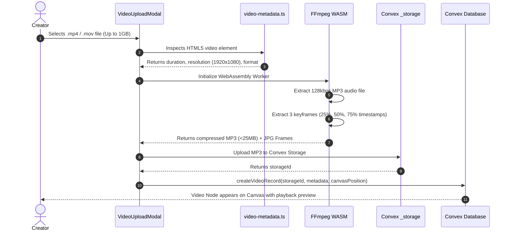
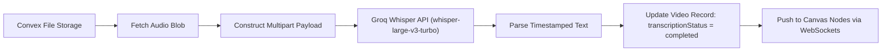
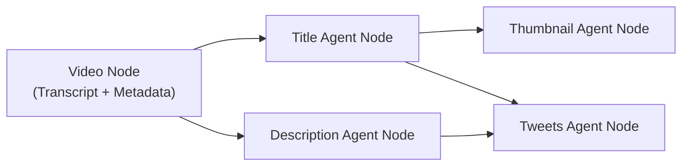

# Loomis — Part 3: Workflow & AI Pipeline

Welcome to **Part 3** of the Loomis documentation series. This document teaches you the exact **step-by-step workflow** of Loomis, from the moment a user uploads a video file to the moment their content package is generated, refined, and previewed.

---

## Complete End-to-End Workflow Diagram

```mermaid
flowchart TD
    Start([Creator Starts New Project]) --> Step1[Configure Channel Profile]
    Step1 --> Step2[Create New Project on Dashboard]
    Step2 --> Step3[Open Visual Canvas]
    
    subgraph Ingestion["Phase 1: Video Ingestion & Client Processing"]
        Step3 --> Step4[Drag & Drop Video / Cmd+U]
        Step4 --> Step5[Client-Side Video Metadata Extraction]
        Step5 --> Step6[FFmpeg WASM: Audio Extraction & Keyframe Capture]
        Step6 --> Step7[Upload Audio & Video to Convex Storage]
    end

    subgraph Transcription["Phase 2: Speech-to-Text Pipeline"]
        Step7 --> Step8{Audio Uploaded?}
        Step8 -->|Yes| Step9[Trigger Groq Whisper API]
        Step9 --> Step10[Store Timestamped Transcript in Database]
        Step8 -->|Manual Fallback| Step11[Upload .SRT / .VTT / .TXT file]
        Step11 --> Step10
    end

    subgraph Generation["Phase 3: Multi-Agent AI Generation"]
        Step10 --> Step12[User triggers 'Generate All' or Individual Agent]
        Step12 --> Step13[Assemble Master Context Payload]
        
        Step13 --> AgentA[Title Agent: GPT-4o CTR Optimization]
        Step13 --> AgentB[Description Agent: 2-Line Benefit + Timestamps]
        Step13 --> AgentC[Thumbnail Agent: Groq Vision + Cloudflare SDXL]
        Step13 --> AgentD[Tweets Agent: Viral 2-Tweet Thread]
    end

    subgraph Iteration["Phase 4: Refinement & Validation"]
        AgentA --> CanvasView[Render Assets on Canvas Nodes]
        AgentB --> CanvasView
        AgentC --> CanvasView
        AgentD --> CanvasView

        CanvasView --> Chat[@mention Chat Refinement]
        Chat -->|Iterate| CanvasView

        CanvasView --> Preview[Realistic YouTube & Twitter Previews]
        Preview --> Export[Export Markdown / Copy to Clipboard]
        Preview --> Share[Generate Public Share Link]
    end
```

---

## Phase 1: Project Initialization & Channel Profiling

Before generating content, AI models need to know **who** is speaking, **what** style they use, and **who** their audience is.

### 1. Channel Profile Configuration (`/dashboard/settings`)
When a user sets up their profile, Loomis stores:
- **Channel Name:** (e.g., `CodeWithAlex`)
- **Niche:** (e.g., `Web Development & Cloud Architecture`)
- **Content Type:** (e.g., `Tutorials, Deep-Dives, Product Reviews`)
- **Brand Tone:** (e.g., `Friendly, Authoritative, Fast-Paced, Concise`)
- **Target Audience:** (e.g., `Junior-to-Midlevel Engineers, Tech Enthusiasts`)
- **Default Links:** (e.g., GitHub repo, Twitter profile, Discord community, newsletter)

> **Why this matters:** When the Title or Description agent generates text, it injects these exact parameters into the system prompt. A tutorial channel gets crisp, step-by-step benefit titles, while an entertainment channel gets story-driven curiosity hooks.

### 2. Creating a Project (`/dashboard`)
- Each project in Loomis corresponds to **one YouTube video**.
- Clicking **"New Project"** creates a record in the `projects` table and initializes an empty canvas with default coordinates in `projectCanvases`.
- The user is redirected to the canvas route: `/dashboard/project/:projectId`.

---

## Phase 2: Video Ingestion & Client-Side Media Engineering

Uploading video files to cloud backends is traditionally slow, expensive, and fragile. Loomis eliminates this bottleneck by performing heavy processing **directly in the user's browser** using WebAssembly.



### Deep-Dive into the Client Pipeline:
1. **Metadata Inspection (`app/lib/video-metadata.ts`):**
   - Instantiates an off-screen HTML5 `<video>` element via `URL.createObjectURL(file)`.
   - Reads `videoWidth`, `videoHeight`, and `duration`.
   - Computes human-readable file sizes (e.g., `124.5 MB`) and aspect ratios (16:9 vs 9:16 Shorts).
2. **WebAssembly Audio Extraction (`app/lib/ffmpeg-audio.ts`):**
   - Loads `@ffmpeg/ffmpeg` with multi-threading support.
   - Runs the command:
     ```bash
     ffmpeg -i input.mp4 -vn -acodec mp3 -b:a 128k output.mp3
     ```
   - **The Breakthrough:** A 900MB video file contains only 15MB of audio. By extracting the audio in-browser, the upload finishes in seconds instead of minutes and stays well below the 25MB Whisper API limit!
3. **Keyframe Extraction (`app/lib/video-frames.ts`):**
   - FFmpeg samples frames at 25%, 50%, and 75% of the video timeline.
   - These frames are converted to base64 data URLs for subsequent vision analysis.

---

## Phase 3: The Transcription Pipeline

Once the audio file is stored in Convex Storage, the transcription pipeline activates automatically.



### 1. Automated Groq Whisper (`convex/transcription.ts`)
- Convex serverless action streams the audio file to `https://api.groq.com/openai/v1/audio/transcriptions`.
- Model: `whisper-large-v3-turbo`.
- Status updates:
  - `idle` $\rightarrow$ Initial state upon upload.
  - `processing` with live progress message (`"Processing with Groq Whisper..."`).
  - `completed` with full transcript text stored in the `videos` record.
  - `failed` with descriptive troubleshooting message if audio is silent.

### 2. Manual Transcript Fallback (`convex/transcriptionUpload.ts` & `TranscriptionNode.tsx`)
- If a creator already has subtitles or was recording without network access:
- Supports drag-and-drop of `.srt`, `.vtt`, and `.txt` files.
- Strips timestamps and SRT index counters to produce clean text for LLM consumption.
- Visualized directly as a distinct `TranscriptionNode` on the canvas.

---

## Phase 4: Multi-Agent AI Generation Engine

Loomis deploys four specialized agents, orchestrated primarily through `convex/aiHackathon.ts` and `convex/thumbnailGPTImage.ts`.

### 1. The Context Aggregator
Before any agent runs, Loomis constructs a **Master Context Payload**:
```typescript
interface MasterContextPayload {
  videoData: {
    title: string;
    transcription: string;        // Full speech transcript
    duration: number;             // Video length in seconds
    resolution: { width: number; height: number };
  };
  connectedAgentOutputs: Array<{
    type: "title" | "description" | "thumbnail" | "tweets";
    content: string;              // Output from upstream connected nodes
  }>;
  profileData: {
    channelName: string;
    niche: string;
    tone: string;
    targetAudience: string;
  };
  moodBoardReferences?: Array<{ url: string; type: string }>;
}
```

---

### 2. The 4 Autonomous Agents

#### Agent 1: The Title Agent (CTR Specialist)
- **Engine:** OpenAI GPT-4o (`temperature: 0.8`, `maxTokens: 100`).
- **Goal:** Generate click-worthy titles that never mislead (avoiding pure clickbait that hurts retention).
- **Optimization Rules Enforced:**
  1. Under 60 characters (prevents truncation on mobile screens).
  2. Front-load high-impact keywords in the first 30 characters.
  3. Formula selection based on video tone:
     - *Educational:* `"How to [Specific Result] in [Timeframe]"`
     - *Story/Case Study:* `"I Tried [Thing] for 30 Days (Here's What Happened)"`
     - *Curiosity Hook:* `"The [Tool] Nobody is Talking About"`

#### Agent 2: The Description Agent (SEO & Retention Specialist)
- **Engine:** OpenAI GPT-4o (`temperature: 0.7`, `maxTokens: 150`).
- **Goal:** Write high-converting YouTube descriptions that hook the viewer in the first two lines (above the fold) and provide clean navigation.
- **Output Structure:**
  - **Lines 1–2:** The viewer benefit hook (what they gain from watching).
  - **Timestamps:** Automatic chapter markers inferred from transcript transitions.
  - **Resources Mentioned:** Links to tools, code repos, or references.
  - **Channel Bio & Socials:** Injected automatically from channel profile.
  - **SEO Hashtags:** 3–5 targeted tags.

#### Agent 3: The Thumbnail Agent (Visual Concept & Synthesis)
- **Engine:** Two-tier hybrid architecture:
  1. **Concept Vision Analysis:** Groq Vision (`meta-llama/llama-4-scout-17b-16e-instruct`) or GPT-4o Vision inspects the extracted video frames. It identifies high-contrast focal points, emotional facial expressions, and subject matter.
  2. **Image Synthesis:** Cloudflare Workers AI (`@cf/stabilityai/stable-diffusion-xl-base-1.0`) generates a crisp, photorealistic 16:9 image based on the vision prompt.
  3. **Permanent Archiving:** The resulting image blob is stored directly in Convex Storage (`_storage`) and linked to the agent node.
  4. **Iterative Refinement (`thumbnailRefine.ts`):** Uses SDXL image-to-image (`cfImageToImage`) with adjustable denoising strength (0.65), allowing users to tweak colors, text, or elements while keeping the core subject intact!

#### Agent 4: The Tweets Agent (Social Distribution Strategist)
- **Engine:** OpenAI GPT-4o (`temperature: 0.8`, `maxTokens: 200`).
- **Goal:** Transform the video's core lesson into a high-engagement Twitter/X thread.
- **Output Format:**
  - **Tweet 1 (The Hook):** Strong contrarian statement or problem teaser that earns the click.
  - **Tweet 2 (The Value & Link):** Key takeaway summary, attached thumbnail preview, and call-to-action link to the full YouTube video.

---

## Phase 5: Visual Canvas Dynamics & Node Graph Flow

The canvas is not merely a visual layout—it is an **active dependency graph**.



### Node Interaction Features:
- **Handle Snapping:** Creators drag connections from node outputs to inputs.
- **Dynamic Context Passing:** When `TitleNode` is connected to `ThumbNode`, the thumbnail prompt automatically includes: *"Incorporating the title '[Selected Title]' into the visual theme."*
- **Collision Detection & Auto-Layout:** Adding multiple nodes calculates bounding boxes to prevent overlapping nodes on creation.
- **Auto-Save Engine:** Changes to node positions (`x`, `y`), zoom level, and active edges are debounced and synchronized to Convex `projectCanvases` every 5 seconds.

---

## Phase 6: Floating Chat & Agent @Mention System

While nodes offer one-click "Regenerate" buttons, creators often want nuanced, conversational revisions.

```
+-------------------------------------------------------------+
|  Loomis Chat Assistant                                  |
+-------------------------------------------------------------+
|  User: @title make it sound more urgent and mention Next.js |
|                                                             |
|  AI: I've updated the Title Agent draft:                    |
|      "Stop Using React Router Wrong! (Next.js vs RR7)"      |
|      [Apply to Node]                                        |
+-------------------------------------------------------------+
```

### How the @Mention System Works (`app/components/canvas/FloatingChat.tsx`):
1. **Mention Autocomplete (`MentionAutocomplete.tsx`):**
   - Typing `@` triggers an autocomplete menu listing all active agents: `@title`, `@description`, `@thumbnail`, `@tweets`.
2. **Context Routing (`convex/chat.ts`):**
   - The backend extracts the target agent from the message.
   - It fetches the agent's current draft, video transcript, and connected outputs.
   - It executes a conversational prompt with GPT-4o instructing the model to update that specific asset according to the user's feedback.
3. **Instant Live Updating:**
   - Once generated, the agent's draft on the canvas updates in real time via Convex reactive queries.

---

## Phase 7: Simulation, Markdown Export & Sharing

Once content is generated, creators can inspect, test, and distribute their work.

### 1. Authentic Platform Previews (`app/components/preview/`)
- **YouTube Preview (`YouTubePreview.tsx`):**
  - Displays a realistic YouTube desktop/mobile video watch page.
  - Renders the generated thumbnail inside a 16:9 video frame.
  - Displays the generated title, channel subscriber badge, view counts, and collapsible description box.
- **Twitter Thread Preview (`TwitterThreadPreview.tsx`):**
  - Renders authentic Twitter/X cards complete with user handle, verified badge, tweet text, formatted hashtags, and attached thumbnail image.

### 2. Markdown Export & Clipboard
- **Copy to Clipboard:** One-click copy for titles, descriptions, and tweet copy.
- **Markdown Export:** Generates a structured `.md` file containing the entire video package, ready to paste directly into YouTube Studio or Notion content calendars.

### 3. Public Read-Only Share Links (`/share/:shareId`)
- Creators can click **"Share Canvas"** to generate a unique public URL.
- Stored in the `shares` table with an active view counter.
- Allows clients, sponsors, or video editors to explore the interactive canvas and inspect all drafts without having edit permissions or needing an account.

---

### Continue Reading:
- **[Part 1: Project Overview & Architecture](./PART_1_PROJECT_OVERVIEW.md)**
- **[Part 2: Tech Stack & Tools Deep Dive](./PART_2_TECH_STACK_AND_TOOLS.md)**
- **[Part 4: Database Schema, API & Deployment](./PART_4_DATABASE_SCHEMA_AND_API.md)**
