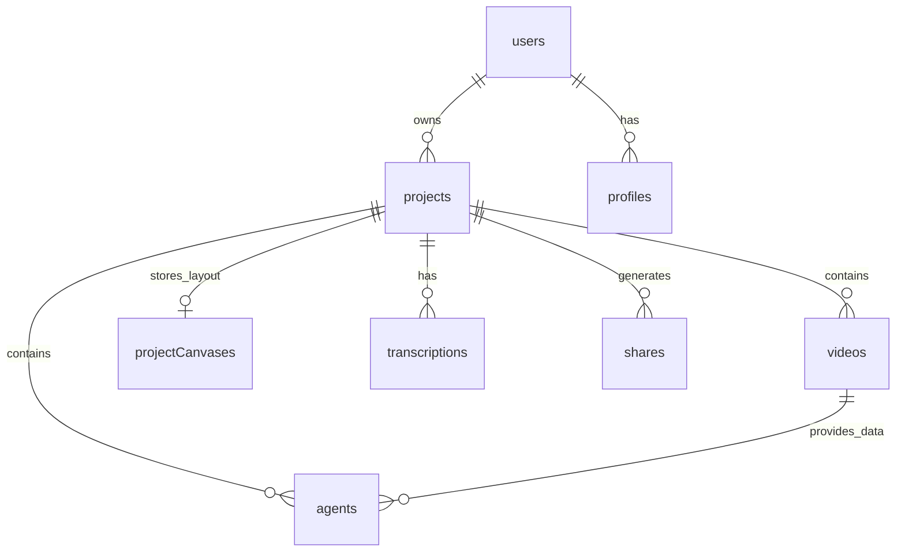

# Loomis — Part 4: Database Schema, API & Deployment

Welcome to **Part 4** of the Loomis documentation series. This document serves as the **technical backend and operations reference**, detailing the Convex database schema, serverless function architecture, environment variable configuration, and deployment strategies.

---

## Table of Contents
1. [Convex Reactive Database Schema](#1-convex-reactive-database-schema)
2. [Convex Backend Functions & Modules Overview](#2-convex-backend-functions--modules-overview)
3. [Environment Variables Master Reference](#3-environment-variables-master-reference)
4. [Local Development Setup](#4-local-development-setup)
5. [Production Deployment Guide](#5-production-deployment-guide)
6. [Common Pitfalls & Troubleshooting](#6-common-pitfalls--troubleshooting)

---

## 1. Convex Reactive Database Schema

The database is defined in `convex/schema.ts` using Convex's type-safe schema definition language.



### Table 1: `users`
Stores authenticated creator account details linked to Clerk.
- **Fields:**
  - `name`: `v.optional(v.string())` — User's display name.
  - `email`: `v.optional(v.string())` — User's primary email.
  - `image`: `v.optional(v.string())` — User avatar URL.
  - `tokenIdentifier`: `v.string()` — Unique Clerk JWT subject token identifier.
- **Indexes:**
  - `by_token`: `["tokenIdentifier"]` — Used for lightning-fast auth verification on every query and mutation.

---

### Table 2: `projects`
Represents an individual video packaging project.
- **Fields:**
  - `userId`: `v.string()` — Owner's token identifier.
  - `title`: `v.string()` — Video or working title of the project.
  - `description`: `v.optional(v.string())` — High-level project notes.
  - `thumbnail`: `v.optional(v.string())` — Preview thumbnail URL for dashboard cards.
  - `createdAt`: `v.number()` — Timestamp in milliseconds.
  - `updatedAt`: `v.number()` — Timestamp of last modification.
  - `isArchived`: `v.boolean()` — Soft-deletion and archiving flag.
- **Indexes:**
  - `by_user`: `["userId"]` — Fetches all projects for the logged-in user.
  - `by_updated`: `["updatedAt"]` — Sorts projects by recent activity.
  - `by_user_archived`: `["userId", "isArchived"]` — Filters active vs. archived projects.

---

### Table 3: `videos`
Stores uploaded video files, media metadata, and transcription state.
- **Fields:**
  - `userId`: `v.string()` — Owner identifier.
  - `projectId`: `v.optional(v.id("projects"))` — Linked project.
  - `title`: `v.optional(v.string())` — Original file name.
  - `videoUrl`: `v.optional(v.string())` — Resolved URL for playback.
  - `storageId`: `v.optional(v.id("_storage"))` — Convex file storage reference ID.
  - `transcription`: `v.optional(v.string())` — Full speech-to-text transcript.
  - `canvasPosition`: `v.object({ x: v.number(), y: v.number() })` — Position on the visual canvas.
  - `duration`: `v.optional(v.number())` — Total video runtime in seconds.
  - `fileSize`: `v.optional(v.number())` — Size in bytes.
  - `resolution`: `v.optional(v.object({ width: v.number(), height: v.number() }))` — Dimensions (e.g. 1920x1080).
  - `frameRate`: `v.optional(v.number())` — FPS (e.g. 30 or 60).
  - `bitRate`: `v.optional(v.number())` — Bitrate in bps.
  - `format`: `v.optional(v.string())` — Video container (e.g. `mp4`, `mov`).
  - `codec`: `v.optional(v.string())` — Video codec (e.g. `h264`, `hevc`).
  - `audioInfo`: `v.optional(v.object({ codec: v.string(), sampleRate: v.number(), channels: v.number(), bitRate: v.number() }))` — Audio track technical parameters.
  - `transcriptionStatus`: `v.optional(v.union("idle", "processing", "completed", "failed"))` — Live job status.
  - `transcriptionProgress`: `v.optional(v.string())` — Human-readable status update.
  - `transcriptionError`: `v.optional(v.string())` — Failure rationale if transcription errors occur.
  - `createdAt`: `v.number()` — Creation timestamp.
- **Indexes:**
  - `by_user`: `["userId"]`
  - `by_project`: `["projectId"]`
  - `by_created`: `["createdAt"]`

---

### Table 4: `agents`
Stores the outputs and configuration for the 4 creative AI agents.
- **Fields:**
  - `videoId`: `v.id("videos")` — Source video reference.
  - `userId`: `v.string()` — Creator token identifier.
  - `projectId`: `v.optional(v.id("projects"))` — Parent project ID.
  - `type`: `v.union("title", "description", "thumbnail", "tweets")` — Agent identity.
  - `draft`: `v.string()` — Current markdown or text output generated by the agent.
  - `thumbnailUrl`: `v.optional(v.string())` — For thumbnail agents: public image URL.
  - `thumbnailStorageId`: `v.optional(v.id("_storage"))` — For thumbnail agents: Convex storage ID.
  - `connections`: `v.array(v.string())` — List of connected node IDs feeding into this agent.
  - `chatHistory`: `v.array(v.object({ role: v.union("user", "ai"), message: v.string(), timestamp: v.number() }))` — Conversational refinement history.
  - `canvasPosition`: `v.object({ x: v.number(), y: v.number() })` — Node canvas coordinates.
  - `status`: `v.union("idle", "generating", "ready", "error")` — Real-time execution status.
  - `createdAt`: `v.number()` — Creation timestamp.
- **Indexes:**
  - `by_video`: `["videoId"]`
  - `by_user`: `["userId"]`
  - `by_project`: `["projectId"]`
  - `by_type`: `["type"]`

---

### Table 5: `profiles`
Stores channel brand personality and default configurations.
- **Fields:**
  - `userId`: `v.string()` — User identifier.
  - `channelName`: `v.string()` — YouTube channel name.
  - `contentType`: `v.string()` — Category (e.g. Gaming, Tech, Cooking).
  - `niche`: `v.string()` — Specific domain focus.
  - `links`: `v.array(v.string())` — Social handles and website links.
  - `tone`: `v.optional(v.string())` — Brand voice (e.g., Casual, Analytical).
  - `targetAudience`: `v.optional(v.string())` — Target demographic summary.
  - `createdAt`: `v.number()`
  - `updatedAt`: `v.number()`
- **Indexes:**
  - `by_user`: `["userId"]`

---

### Table 6: `projectCanvases`
Serializes the state of the interactive visual canvas for persistence across sessions.
- **Fields:**
  - `userId`: `v.string()` — User identifier.
  - `projectId`: `v.id("projects")` — Linked project.
  - `nodes`: `v.array(v.object({ id: v.string(), type: v.string(), position: v.object({ x: v.number(), y: v.number() }), data: v.any() }))` — All React Flow nodes and their properties.
  - `edges`: `v.array(v.object({ id: v.string(), source: v.string(), target: v.string(), sourceHandle: v.optional(v.string()), targetHandle: v.optional(v.string()) }))` — All connections.
  - `viewport`: `v.object({ x: v.number(), y: v.number(), zoom: v.number() })` — Viewport pan and zoom levels.
  - `updatedAt`: `v.number()` — Timestamp of last auto-save.
- **Indexes:**
  - `by_user`: `["userId"]`
  - `by_project`: `["projectId"]`

---

### Table 7: `shares`
Enables read-only public sharing of canvases with collaborators or clients.
- **Fields:**
  - `shareId`: `v.string()` — Cryptographically random URL slug.
  - `projectId`: `v.id("projects")` — Target project.
  - `userId`: `v.string()` — Creator who published the share.
  - `canvasState`: `v.object({ nodes: v.array(v.any()), edges: v.array(v.any()), viewport: v.optional(v.any()) })` — Frozen snapshot of the canvas.
  - `viewCount`: `v.number()` — Total hits on the shared link.
  - `createdAt`: `v.number()`
  - `updatedAt`: `v.number()`
- **Indexes:**
  - `by_shareId`: `["shareId"]`
  - `by_project`: `["projectId"]`

---

### Table 8: `transcriptions`
Stores standalone or custom-uploaded transcriptions (e.g. from `.srt` or `.vtt` files).
- **Fields:**
  - `userId`: `v.string()`
  - `projectId`: `v.id("projects")`
  - `videoId`: `v.optional(v.id("videos"))`
  - `fileName`: `v.string()`
  - `format`: `v.string()` (e.g. `srt`, `vtt`, `txt`)
  - `fullText`: `v.string()`
  - `segments`: `v.optional(v.array(v.object({ start: v.number(), end: v.number(), text: v.string() })))`
  - `wordCount`: `v.number()`
  - `duration`: `v.optional(v.number())`
  - `fileStorageId`: `v.optional(v.id("_storage"))`
  - `canvasPosition`: `v.object({ x: v.number(), y: v.number() })`
  - `createdAt`: `v.number()`

---

## 2. Convex Backend Functions & Modules Overview

The `convex/` directory contains all backend actions, mutations, and queries:

| File | Purpose & Key Functions |
| :--- | :--- |
| `convex/aiProviders.ts` | **AI Driver Layer:** Contains `groqVisionChat` (Groq vision completions), `cfTextToImage` (Cloudflare Workers AI SDXL synthesis), `cfImageToImage` (SDXL refinement), and `requireEnv`. |
| `convex/aiHackathon.ts` | **Core Content Generation:** `generateContentSimple` coordinates GPT-4o copywriting for Title, Description, and Tweet agents using custom prompt templates and parameter tuning. |
| `convex/thumbnail.ts` | **Thumbnail Orchestrator:** Manages vision frame extraction, prompt formulation, fallback to DALL-E 3, and image persistence. |
| `convex/thumbnailGPTImage.ts` | **SDXL Pipeline:** Ingests video frames and title context to synthesize photorealistic 16:9 thumbnail images via Cloudflare Workers AI. |
| `convex/thumbnailRefine.ts` | **Img2Img Refinement:** Accepts an existing thumbnail image and prompt instructions to re-render the image with high structural fidelity. |
| `convex/transcription.ts` | **Groq Speech-to-Text:** `transcribeVideoGroq` pulls the audio blob from Convex storage, calls Groq Whisper, and writes the transcript to the database. |
| `convex/transcriptionUpload.ts` | **Manual Subtitles:** Handles uploaded `.srt`, `.vtt`, and `.txt` files, parsing them into clean transcript records. |
| `convex/videos.ts` | **Media CRUD:** `generateUploadUrl`, `createVideo`, `updateVideoTranscription`, `updateCanvasPosition`, and `getVideo`. |
| `convex/canvas.ts` | **Canvas State Engine:** `saveProjectCanvas` (debounced auto-save) and `getProjectCanvas` (restores nodes, edges, and zoom). |
| `convex/agents.ts` | **Agent Management:** CRUD operations for agent nodes, connection tracking, and status transitions (`idle` $\rightarrow$ `generating` $\rightarrow$ `ready`). |
| `convex/chat.ts` | **Conversational Assistant:** Appends user messages, parses `@mentions`, and triggers contextual agent regeneration. |
| `convex/projects.ts` | **Project Manager:** `createProject`, `getProjects`, `getProjectById`, `archiveProject`, and `deleteProject`. |
| `convex/shares.ts` | **Public Links:** `createShare`, `getShare`, and `incrementShareViewCount`. |
| `convex/profiles.ts` | **User Preferences:** Channel profile updates and retrievals for prompt injection. |
| `convex/http.ts` | **HTTP Endpoints:** Webhook receiver for payments (Polar) and third-party integrations. |
| `convex/auth.config.ts` | **Clerk Identity Provider:** Maps Clerk JWT authentication issuer to Convex backend. |

---

## 3. Environment Variables Master Reference

Loomis requires two sets of environment variables: **Client/Server Application Variables** (stored in `.env.local`) and **Convex Action Variables** (stored in the Convex Dashboard).

### Application Variables (`.env.local`)

```bash
# ─── Convex Configuration ─────────────────────────────────────
# Convex deployment name (provided by `npx convex dev`)
CONVEX_DEPLOYMENT=dev:Loomis-ai-12345

# Public Convex client WebSocket & HTTP URL
VITE_CONVEX_URL=https://your-deployment-name.convex.cloud

# ─── Clerk Authentication ─────────────────────────────────────
# Clerk publishable key for client-side authentication
VITE_CLERK_PUBLISHABLE_KEY=pk_test_...

# Clerk secret key for server-side route authentication
CLERK_SECRET_KEY=sk_test_...

# Optional Clerk frontend API URL
VITE_CLERK_FRONTEND_API_URL=https://...

# ─── Frontend App URL ─────────────────────────────────────────
# Base application URL for sharing links and redirect callbacks
FRONTEND_URL=http://localhost:5173
```

### Convex Dashboard Variables
Set these via `npx convex env set <KEY> <VALUE>` or directly in your Convex Cloud Dashboard under **Settings $\rightarrow$ Environment Variables**:

| Variable Name | Required For | Description |
| :--- | :--- | :--- |
| `OPENAI_API_KEY` | GPT-4o & DALL-E 3 | Powers Title, Description, Tweet generation, and fallback thumbnail generation. |
| `GROQ_API_KEY` | Whisper & Vision | Powers ultra-fast audio transcription (`whisper-large-v3-turbo`) and frame vision analysis. |
| `CF_ACCOUNT_ID` | Cloudflare Workers AI | Your Cloudflare account ID for running serverless SDXL models. |
| `CF_API_TOKEN` | Cloudflare Workers AI | API token with permissions for **Workers AI (Read/Edit)**. |

---

## 4. Local Development Setup

Follow these steps to run Loomis locally:

### Step 1: Clone and Install
```bash
git clone https://github.com/your-username/Loomis-AI.git
cd Loomis-AI
npm install
```

### Step 2: Configure Environment Files
```bash
cp .env.example .env.local
```
Fill in your Clerk publishable and secret keys, and your frontend URL (`http://localhost:5173`).

### Step 3: Initialize Convex
```bash
npx convex dev
```
- This command authenticates your machine with Convex, creates a development database, and writes `CONVEX_DEPLOYMENT` and `VITE_CONVEX_URL` into your `.env.local`.
- Set your backend AI keys:
```bash
npx convex env set OPENAI_API_KEY "your_openai_key"
npx convex env set GROQ_API_KEY "your_groq_key"
npx convex env set CF_ACCOUNT_ID "your_cloudflare_account_id"
npx convex env set CF_API_TOKEN "your_cloudflare_api_token"
```

### Step 4: Start the Dev Server
In a separate terminal:
```bash
npm run dev
```
Open your browser at `http://localhost:5173`.

---

## 5. Production Deployment Guide

### Option A: Vercel Deployment (Recommended)
Loomis includes the `@vercel/react-router` preset in `react-router.config.ts`, making Vercel deployment seamless:

1. Push your repository to GitHub or GitLab.
2. Import the repository in [Vercel](https://vercel.com).
3. In **Project Settings $\rightarrow$ Environment Variables**, add:
   - `VITE_CONVEX_URL`
   - `VITE_CLERK_PUBLISHABLE_KEY`
   - `CLERK_SECRET_KEY`
   - `FRONTEND_URL` (set to your production domain, e.g. `https://Loomis.ai`)
4. In Convex Cloud Dashboard, ensure production environment variables (`OPENAI_API_KEY`, `GROQ_API_KEY`, `CF_ACCOUNT_ID`, `CF_API_TOKEN`) are configured for the production deployment.
5. Deploy! Vercel automatically runs `npm run build` and provisions edge SSR.

---

### Option B: Docker Container Deployment
Loomis includes a production-grade multi-stage `Dockerfile`:

```bash
# 1. Build the Docker container
docker build -t Loomis-ai .

# 2. Run the container locally or on a VPS
docker run -p 3000:3000 \
  -e VITE_CONVEX_URL="https://your-app.convex.cloud" \
  -e VITE_CLERK_PUBLISHABLE_KEY="pk_live_..." \
  -e CLERK_SECRET_KEY="sk_live_..." \
  -e FRONTEND_URL="https://your-domain.com" \
  Loomis-ai
```
The Docker container can be deployed to:
- **AWS ECS / Fargate**
- **Google Cloud Run**
- **Railway**
- **Fly.io**
- **DigitalOcean App Platform**

---

## 6. Common Pitfalls & Troubleshooting

### 1. FFmpeg WebAssembly Cross-Origin Isolation
- **Symptom:** FFmpeg throws `SharedArrayBuffer is not defined` or fails to load WebAssembly.
- **Cause:** WebAssembly multi-threading requires browser security headers:
  ```http
  Cross-Origin-Opener-Policy: same-origin
  Cross-Origin-Embedder-Policy: require-corp
  ```
- **Fix:** In `vite.config.ts`, ensure headers are injected for local development, and configure matching headers on your production hosting CDN.

### 2. Large Video File Processing
- **Symptom:** Browser tab slows down or crashes when uploading videos >500MB.
- **Fix:** Ensure client-side audio extraction (`app/lib/ffmpeg-audio.ts`) runs before uploading. The app will extract the audio track to MP3, discarding raw 4K video frames and keeping memory footprint under 200MB.

### 3. Groq Rate Limits (429)
- **Symptom:** Transcription fails with `Groq rate limit exceeded`.
- **Fix:** `convex/transcription.ts` detects status 429 and provides user feedback. If you hit free-tier rate limits, upgrade your Groq API tier or upload transcripts manually using the `TranscriptionNode`.

### 4. Hydration Mismatches on React Flow Canvas
- **Symptom:** Browser console warning regarding SSR hydration mismatch inside the canvas.
- **Fix:** Canvas components must render exclusively on the client. Always wrap React Flow nodes inside `ClientCanvas.tsx` or `ClientOnly.tsx`.

---

## Complete Documentation Index

Congratulations! You now have a comprehensive understanding of the entire Loomis architecture:
- **[Part 1: Project Overview & Architecture](./PART_1_PROJECT_OVERVIEW.md)**
- **[Part 2: Tech Stack & Tools Deep Dive](./PART_2_TECH_STACK_AND_TOOLS.md)**
- **[Part 3: Workflow & AI Pipeline](./PART_3_WORKFLOW_AND_AI_PIPELINE.md)**
- **[Part 4: Database Schema, API & Deployment](./PART_4_DATABASE_SCHEMA_AND_API.md)**
